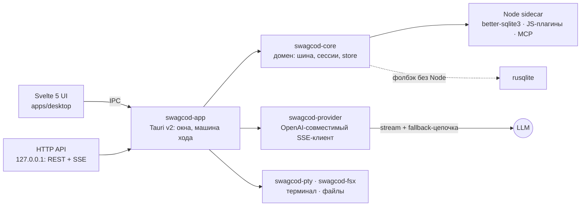

<div align="center">

# ◆ SwagCod

**Десктопный код-агент: Rust-ядро, Tauri v2, Svelte 5. Всё локально, всё твоё.**

Модель читает, пишет и запускает код по твоей задаче: инструменты с подтверждениями,
MCP-серверы, JS-плагины, суб-агенты, семантический поиск, фоновые задачи,
персистентная память в трёх областях, уведомления, loopback REST API и дашборд
телеметрии — в нативном окне с холодным стартом **40 мс**.

[](https://github.com/Swwag666/SwagCode/actions/workflows/ci.yml)
[](https://github.com/Swwag666/SwagCode/actions/workflows/release.yml)


-orange)


</div>

---

## Что умеет

| | |
|---|---|
| 💬 **Живой стрим** | Инкрементальный markdown с подсветкой, reasoning-поток, курсор стрима, токены и ток/с, очередь реплик, стоп-кнопка |
| 🧠 **Живые мысли** | Reasoning стримится в транскрипт токенами прямо во время хода, а не появляется целиком в конце: режим «живые» или «все» (включая завершённые). Мысли принимаются из `reasoning_content`, `reasoning` или `thinking` — шлюзы кладут их в разные поля |
| 🗂 **Память** | Три области: глобальные факты (вшиваются в промпт каждого хода), заметки сессии, факты рабочей папки. Запись многострочная (кап 4000), импорт и экспорт txt/md, селектор сессии — править память можно любой сессии, не переключая активный чат |
| 🔔 **Уведомления** | Звук и toast: ход завершён, ошибка, запрос подтверждения. Звук синтезируется встроенно, внешних файлов нет; без аудиоустройства (headless, RDP без звука) звук молча пропускается, а уведомление работает |
| ♻️ **Hot-reload** | MCP-серверы, JS-плагины и скиллы перечитываются без перезапуска приложения — правка файла или новая запись в реестре подхватываются по кнопке |
| 📁 **Правила папки** | Набор на рабочую папку и её подпапки: allow/deny команд, отключение MCP/плагинов/скиллов, `system_prompt_append`, свой TTL сессий, исключение из очистки. Плюс авто-очистка: фоновый воркер сносит старые сессии по TTL |
| 🎛 **Модель по сессиям** | Каждая сессия помнит свою модель и не переключает глобальную; тумблер в настройках, сброс на глобальную одной кнопкой |
| 🔀 **Провайдеры** | 12 пресетов (OpenAI, Anthropic, Kimi, DeepSeek, OpenRouter, Zen, Gemini, Groq, Mistral, xAI, Ollama, LM Studio) + custom со своим endpoint; нативный клиент Anthropic `/v1/messages`; ключи под DPAPI, наружу только `has_key`; Fetch models с превью и явным сохранением |
| 🛠 **Инструменты** | Файлы (read/write/edit), поиск (grep/glob), bash/pwsh через песочницу, fetch_url — всё с журналированием и подтверждениями |
| 🔌 **MCP** | Внешние инструменты по Model Context Protocol (stdio): реестр серверов, статусы, общий список тулов с встроенными |
| 🧩 **JS-плагины** | `plugins/*.js` в изолированном vm-контексте sidecar'а: дедлайн, read-only prefs, `swagcod.define({name, handler})` |
| 🤖 **Суб-агенты** | Инструмент `subagent` — изолированная ветка хода: только безопасные тулы, своя дешёвая модель (аргумент `model`), бюджет токенов и раундов, отчёт родителю, дерево ходов в UI |
| 🔎 **Семантический поиск** | Embeddings-индекс воркспейса (облако или локальный лексический фолбэк), кэш в отдельной базе, периодическая переиндексация |
| 📚 **Поиск по истории** | FTS5-индекс всех сообщений (текст и reasoning) во всех сессиях: `/search` в палитре, сниппет с подсветкой совпадений, находка открывает свою сессию. Префиксный и регистронезависимый; слова должны встретиться внутри одного сообщения; пустой запрос — ошибка, а не «нашлось всё» |
| 📋 **Фоновые задачи** | Очередь в SQLite, воркер с экспоненциальным backoff (30 с → 30 мин, до 5 попыток), периодические задачи, восстановление сирот после краша |
| 🌐 **HTTP API** | Loopback REST + SSE рядом с шиной: те же команды, что IPC. Bearer-токен под DPAPI, по умолчанию выключен |
| 📈 **Телеметрия** | Таблица `metrics`, сэмпл раз в минуту, латентность провайдера на первый токен стрима; дашборд: токены/день, латентность, лаги шины |
| 📥 **Импорт из DSH** | Перенос истории DSH Desktop (`session.v3.jsonl.zstd`) — идемпотентно, отдельным соединением, догрузка оборванных сессий, конфиги MCP/плагинов; запуск кнопкой в настройках |
| 🖥 **Терминал** | Настоящий PTY с ANSI-парсером и кольцевым буфером |
| 🔐 **Безопасность** | API-ключ под DPAPI Windows, политики подтверждений (глобальная + per-session), журнал одобрений, песочница путей fsx |
| 🎨 **Внешность** | 4 темы, студия (свой акцент, тонировка, медиафон gif/mp4/webm), масштаб окна 60–200%, свои штриховые SVG-иконки — эмодзи в UI нет |

**Горячие клавиши:** ⌘K ввод · ⌘P палитра команд · ⌘F поиск · ⌘M модель · ⌘B панель · ⌘±/0 масштаб

## Что нового: ревизии 51–59

| Ревизия | Что сделано | Где смотреть в приложении |
|---|---|---|
| **51–52** | **Уведомления.** Бэкенд: звуки и toast на завершение хода, ошибку и запрос подтверждения, три Tauri-команды и хранение настроек. Затем UI: вкладка настроек со звуком, тостом и громкостью. Звук синтезируется встроенно — внешних файлов и библиотек-ассетов нет | Настройки → Уведомления |
| **53** | **Hot-reload.** MCP-серверы, JS-плагины и скиллы перечитываются без перезапуска: у каждого списка своя перезагрузка, ошибки показываются рядом, а не в консоли | Настройки → MCP · Плагины · Скиллы |
| **54** | **Правила папки и авто-очистка.** Правила резолвятся от подпапки к корню: allow/deny команд, отключение MCP/плагинов/скиллов, `system_prompt_append`, TTL сессий, исключение из очистки. Отдельный воркер чистит старые сессии по TTL; конфиг живёт в prefs, правила — в JSON/MD файлах | Настройки → Безопасность → Правила папки |
| **55–56** | **Память в трёх областях.** Глобальные факты, заметки сессии, факты рабочей папки. Импорт промпта из txt/md и экспорт записи обратно в файл, селектор сессии, многострочные факты, кап строки 4000 символов | Настройки → Память |
| **57** | **PR #3** (внешний вклад, слит merge-коммитом): живые мысли в стриме, скролл чата без дыр (кэш высот и добор окна), контекстные меню закрываются кликом вне, миникарта убрана, модель по сессиям, `max_tokens=32768` и `reasoning_effort=high`, двухступенчатая остановка хода, повторы роутера, опциональное аудиоустройство | чат · Настройки → General |
| **58–59** | **Автообновление починено.** Диагноз: релизов не было вообще (эндпоинт отдавал 404), прогон `Release` на теге упал на тестах, секретов подписи не существовало. Выставлены секреты, синхронизирован `Cargo.lock`, исправлен `beforeBuildCommand`, версия поднята до 0.2.1, релиз опубликован и подпись проверена | Настройки → General → Обновления |

Три вещи в этих ревизиях имеют неочевидную семантику — их стоит знать:

**Факт папки не наследуется в подпапки.** Правила папки резолвятся от листа к
корню (унаследованный запрет защищает), а факты памяти принадлежат ровно той
папке, где сохранены: унаследованный факт молча менял бы поведение модели там,
где он не действует. Совпадение пути побайтовое по `cwd` хода — один и тот же
каталог, открытый по разным путям, даст две разные области.

**Длинный промпт живёт в файле, а не в памяти.** Кап строки памяти — 4000
символов (столько же, сколько секция фактов в промпте), поэтому импортированный
промпт помещается целиком. Текст длиннее — это `.swagcod/rules.md` папки, у него
кап 8000: он и создан для промпта на весь проект.

**Поднятие версии обязано нести `Cargo.lock`.** `Release` гоняет
`cargo test --locked`, и рассинхрон роняет шаг до всякой сборки. Автообновление
сравнивает версии по semver, поэтому переопубликовать тот же номер бессмысленно —
доставка не сработает.

## Архитектура



| Крейт | Зона | Принцип |
|---|---|---|
| `swagcod-core` | шина событий, сессии, машина хода, контракт Store | **без tauri и без async-рантайма** — headless-тесты и бенчи |
| `swagcod-provider` | OpenAI-совместимый клиент, SSE-парсер, fallback-цепочка B-6 | облако, агрегаторы, Ollama/llama.cpp одним кодом |
| `swagcod-pty` | PTY, ANSI, кольцевой буфер | |
| `swagcod-fsx` | файлы, watch, diff, песочница путей | |
| `swagcod-app` | Tauri-обёртка: окна, IPC, воркеры, HTTP API | тонкий слой над ядром |

Хранилище — better-sqlite3 в Node-sidecar'е (как просил пользователь), аварийный
фолбэк — встроенный rusqlite; контракт `Store` один на оба бэкенда, паритет
покрыт тестами.

## HTTP API (E-7)

По умолчанию **выключен**. Включи портом и перезапусти: `SWAGCOD_HTTP_PORT=47479`
(или prefs-ключ `http_api_port`). Токен (32 байта CSPRNG, хранение под DPAPI)
показывается в Настройки → Безопасность. Слушает только `127.0.0.1`.

| Метод | Маршрут | Что делает |
|---|---|---|
| GET | `/health` | liveness без токена |
| GET | `/v1/diagnostics` | шина, лаги, активные ходы, uptime |
| GET | `/v1/sessions` | список сессий (`SessionBrief[]`) |
| GET | `/v1/models` | каталог моделей активного провайдера (F-9) |
| POST | `/v1/sessions` | `{cwd, model?}` → `SessionBrief` (F-9) |
| POST | `/v1/sessions/transcript` | `{session_id}` → лента сессии в wire-формате B-8 (F-9) |
| POST | `/v1/turns` | `{session_id, message, model?, temperature?}` → `{turn_id}` |
| POST | `/v1/turns/stop` | `{session_id}` → остановка живого хода (F-9) |
| POST | `/v1/turns/revert` | `{session_id, turn_id}` → откат к git-снимку хода (F-5) |
| POST | `/v1/checkpoints` | `{session_id}` → какие ходы можно откатить (F-5) |
| POST | `/v1/approvals` | `{call_id, decision: approved\|denied}` |
| GET | `/v1/events` | SSE-поток всех событий шины |

Все маршруты, кроме `/health`, требуют `Authorization: Bearer <токен>`.
POST-маршруты — только с JSON-телом: query-строка в парсере отбрасывается
(`parse_head`), поэтому даже «чтение» (`/v1/checkpoints`,
`/v1/sessions/transcript`) сделано POST-ом. Ошибки — честные 400/401/404 с
`{"error":"…"}`; SSE не рвётся на лаге broadcast, а шлёт комментарий
`: lagged N`.

```bash
TOKEN=...   # Настройки → Безопасность → «Копировать токен»
curl -s http://127.0.0.1:47479/v1/diagnostics -H "Authorization: Bearer $TOKEN"
curl -s http://127.0.0.1:47479/v1/turns -H "Authorization: Bearer $TOKEN" \
  -H 'Content-Type: application/json' \
  -d '{"session_id":"s-1","message":"почини тесты"}'
curl -sN http://127.0.0.1:47479/v1/events -H "Authorization: Bearer $TOKEN"
```

## SwagCod Phone (F-9)

Телефонный клиент — отдельный проект `dsh-phone` (PWA + python-гейтвей на
stdlib, живёт вне этого репозитория). Он подключается к HTTP API SwagCod
адаптером `swagcod_backend.py`: тот же интерфейс бэкенда, что у моста DSH,
поэтому ни HTTP-роутинг гейтвея, ни его long-poll, ни черновики не меняются.
Адаптер переводит RPC-методы телефона в маршруты API и события шины (SSE) — в
события гейтвея, так что телефон получает живой стрим, а не опрос.

Подключение: включить API на `47479`, скопировать токен из Настройки →
Безопасность в `swagcodToken` конфига гейтвея, выставить `"backend":
"swagcod"` и запустить `python gateway.py`. Полное описание, таблица
«метод телефона → маршрут API», каноническая копия адаптера с его 34 тестами и
два скрипта ручной проверки — в [`tools/phone/README.md`](tools/phone/README.md).

```powershell
# сторона SwagCod: 15 проверок API (с -Turn ещё и настоящий ход)
powershell -NoProfile -ExecutionPolicy Bypass -File tools\phone-check.ps1 -Token <hex>
# вся цепочка через гейтвей: 17 проверок, а с --create — 24 (новый чат, ход, стрим)
python tools\phone\phone-gateway-check.py --config <путь>\dsh-phone\config.json --create <папка> --model <id>
```

Чего телефон против SwagCod не умеет: вложения (API принимает только текст),
смена политики подтверждений (намеренно: телефон не должен расширять себе
права удалённо), откат хода (маршрут есть, UI в телефоне нет). Честный список
отдаёт `runtime.getCapabilities`.

## Быстрый старт

Нужны: Rust stable (MSVC), Node 20+, pnpm 11+.

```powershell
cp .env.example .env      # заполни SWAGCOD_API_KEY
pnpm install              # зависимости фронтенда
pnpm --filter swagcod-desktop build          # фронтенд в dist/
cargo build --release -p swagcod-app --features tauri/custom-protocol
# результат: target/release/swagcod-app.exe
```

> ⚠️ Без `--features tauri/custom-protocol` бинарник будет искать localhost:5173
> и покажет ERR_CONNECTION_REFUSED — грабля Tauri v2 (DECISIONS.md §7).

```powershell
cargo test --workspace                       # 521 Rust-тест (1 ignored)
pnpm --filter swagcod-desktop test           # 195 TS-тестов
cargo clippy --workspace --all-targets -- -D warnings
# F-11: сквозная проверка хода без сети и ключей — эхо вместо провайдера
cargo test --release -p swagcod-app --test e2e_smoke
```

## Установка и обновление

**Просто поставить:** скачай `SwagCod-setup.exe` из
[Releases](https://github.com/Swwag666/SwagCode/releases) и запусти —
установка под текущего пользователя (без админа), ярлык в меню Пуск,
WebView2 докачается сам, node-рантайм и sidecar уже внутри установщика.
Текущий релиз — **v0.2.1**.

**Автообновление:** приложение читает манифест `latest.json` из GitHub
Releases (`releases/latest/download/latest.json`), сверяет версию и
подпись minisign, качает новый setup и ставит его. Ручной запуск:
Настройки → General → «Обновления» → «Проверить»; прогресс загрузки
честный, в конце — «Перезапустить сейчас». Неподписанный или чужой
манифест отвергается: подпись обязательна.

**Сборка релиза (для сопровождающих):**

```powershell
# ключ подписи — один раз (генерится в профиль пользователя, вне репы):
npx tauri signer generate -w $env:USERPROFILE\.swagcod-updater\swagcod-updater.key
# релиз локально: setup.exe + .sig + SwagCod.exe + latest.json в releases/
powershell -NoProfile -ExecutionPolicy Bypass -File tools\build-release.ps1 -Sign -Latest
# подпись артефакта против публичного ключа из tauri.conf.json:
python tools\verify-updater-signature.py releases\SwagCod-setup.exe releases\SwagCod-setup.exe.sig
```

Или CI: запушь тег `vX.Y.Z` — workflow `Release` (tauri-action) сам
соберёт NSIS, подпишет артефакты и опубликует релиз с `latest.json`.
Нужны секреты репозитория `TAURI_SIGNING_PRIVATE_KEY` и
`TAURI_SIGNING_PRIVATE_KEY_PASSWORD` (содержимое
`~/.swagcod-updater/swagcod-updater.key` и `password.txt`); выставлены.

Релиз ломается тихо, поэтому перед тегом проверь три вещи:

1. **Версия поднята** в `Cargo.toml` и `crates/app/tauri.conf.json`, и
   **`Cargo.lock` лежит в том же коммите**: `Release` гоняет
   `cargo test --locked`, и рассинхрон роняет шаг до всякой сборки. Тот же
   номер повторно публиковать бессмысленно — апдейтер сравнит semver и
   скажет «обновлений нет».
2. **Секреты подписи на месте** (`gh secret list`). Без них ворота пройдут
   зелёными, а `tauri-action` умрёт: `createUpdaterArtifacts: true` требует
   подписи.
3. **Подпись проверена.** `tools/verify-updater-signature.py` сверяет
   `key_id`, подпись содержимого (Ed25519 над Blake2b-512 prehash) и
   глобальную подпись trusted comment. У `tauri-cli` команды `verify` нет, а
   неверная подпись означает, что обновление не получит никто, причём сборка
   и публикация выглядят при этом зелёными. Режим `--tag vX.Y.Z` проверяет
   уже опубликованный релиз, а не только локальный файл.

> ⚠️ Проверка обновлений идёт анонимным запросом к
> `releases/latest/download/...`, поэтому и репозиторий, и релизы должны быть
> публичными, а релиз — не черновиком: у черновика этот адрес не резолвится, и
> приложение честно покажет ошибку сети вместо «обновлений нет».

## Конфигурация

Ключ провайдера живёт в `.env` (в `.gitignore`) или под DPAPI Windows
(команда «Зашифровать» в Настройки → Безопасность; приоритет: `.env` → DPAPI).

| Переменная | Смысл |
|---|---|
| `SWAGCOD_API_KEY` · `SWAGCOD_BASE_URL` · `SWAGCOD_MODEL` | провайдер (base по умолчанию `https://rustvy.xyz/v1`) |
| `SWAGCOD_FALLBACKS` | B-6: цепочка резервных точек `url\|key\|model;…` (пустой key = локальный эндпоинт) |
| `SWAGCOD_SUMMARIZER_MODEL` | B-3: модель свёртки контекста (пусто = модель сессии) |
| `SWAGCOD_STORE` · `SWAGCOD_NODE` · `SWAGCOD_STORE_SIDECAR` | авто/node/sqlite-бэкенд хранилища |
| `SWAGCOD_EMBEDDINGS_MODEL` · `SWAGCOD_EMBEDDINGS_MODE` · `SWAGCOD_SEMANTIC_DB` | E-2: семантический поиск |
| `SWAGCOD_MCP_TIMEOUT_MS` | E-3: таймаут инструмента MCP (дефолт 60000) |
| `SWAGCOD_PLUGINS_DIR` · `SWAGCOD_JS_TIMEOUT_MS` | E-4: каталог и дедлайн JS-плагинов |
| `SWAGCOD_TASKS_POLL_MS` | E-5: период воркера задач (дефолт 15000) |
| `SWAGCOD_SUBAGENT_MAX_ROUNDS` · `SWAGCOD_SUBAGENT_BUDGET_TOKENS` | E-6: лимиты ветки суб-агента |
| `SWAGCOD_HTTP_PORT` | E-7: порт loopback REST API (не задан — выключен) |
| `SWAGCOD_APPEARANCE` · `SWAGCOD_BG_MODE` | оверрайды темы и фона при старте |
| `SWAGCOD_ECHO_PROVIDER` | F-11: вместо боевого провайдера — встроенное эхо (ответ = «эхо: <сообщение>», счёт токенов честный). Сети и ключа не требует, в журнале провайдер виден как `echo`. Для сквозных проверок и CI; `0`/`false`/`off`/пусто — выключено |

Полный шаблон с комментариями — [`.env.example`](.env.example).

## Бюджеты — числа, не ощущения

Прогон `tools/bench-startup.ps1` против свежего release-бинарника (i5-10400F / 16 ГБ,
Windows); закоммичено в `bench-out/startup.json`. Старт, память и размер exe —
из того прогона, бандл и тесты перемерены на rev 59:

| Метрика | Цель | Факт |
|---|---|---|
| Холодный старт до окна | < 400 мс | **40.1 мс** медиана (лучший 33.9) |
| Private bytes нашего процесса | < 40 МБ | **16.7 МБ** |
| Private bytes всей семьи | < 200 МБ | 545.4 МБ — вне бюджета: семья WebView2, справочно (D-013) |
| RSS нашего процесса | < 150 МБ | 681.4 МБ — вне бюджета, справочно |
| Размер release-exe | — | 13.2 МБ (портативная сборка, справочно) |
| JS-бандл | < 435 000 Б | **428 383 Б** |
| Тесты | все зелёные | **716** (521 Rust + 195 TS) |
| Clippy · svelte-check | 0 · 0/0 | ✅ |

Таблица переписывается только реальным прогоном: числа в README без строки
в `startup.json` — ложь. Порог бандла поднимается явно и с обоснованием в
комментарии `ci.yml`, а не подгонкой: минификация и «срежем пару килобайт»
здесь не применяются.

## Статус расширений

Планы [`BACKEND_EXTENSIONS.md`](BACKEND_EXTENSIONS.md) (фаза 1) и
[`BACKEND_PHASE2.md`](BACKEND_PHASE2.md) (фаза 2, зрелость агента) закрыты
целиком:

| Этап | Что | Ревизия |
|---|---|---|
| E-1 | Хранилище в Node-sidecar (better-sqlite3) | 25 |
| E-2 | Семантический поиск на embeddings | 26 |
| E-9 | Импорт сессий из DSH Desktop | 29 |
| E-3 | MCP-клиент (stdio) | 30 |
| E-4 | JS-плагины в sidecar (vm, дедлайн) | 31 |
| E-5 | Фоновые задачи + планировщик | 32 |
| E-6 | Суб-агенты и дерево ходов | 33 |
| E-7 | Локальный HTTP API (loopback, DPAPI-токен) | 34 |
| E-8 | Дашборд телеметрии | 35 |
| F-1 | Отмена задачи из тела телеметрии | 38 |
| F-2 | Палитра команд v2 (slash-команды с описаниями) | 39 |
| F-3 | allow/deny-list команд в подтверждениях | 40 |
| F-4 | Инструмент `web_search` | 41 |
| F-5 | git-чекпоинты ходов и откат | 42 |
| F-6 | diff-review для edit/write в подтверждениях | 43 |
| F-7 | Персистентная память (таблица + инструменты + UI) | 44 |
| F-8 | hooks (pre/post turn, pre_tool) | 45 |
| F-9 | SwagCod Phone на loopback HTTP API | 46 |
| F-10 | Гигиена файлов, компоненты `App.svelte`, FTS5-поиск | 47–48 |
| F-11 | E2E-smoke и компонентные тесты в CI | 49 |

Дальше — три фичи из запроса владельца, память в трёх областях и починка
доставки:

| Ревизия | Что |
|---|---|
| 51–52 | Уведомления: звук и toast, бэкенд и UI настроек |
| 53 | Hot-reload MCP, JS-плагинов и скиллов |
| 54 | Правила папки и авто-очистка сессий |
| 55–56 | Память в трёх областях, импорт и экспорт txt/md |
| 57 | PR #3: живые мысли, скролл без дыр, контекстные меню, модель по сессиям |
| 58–59 | Автообновление: диагноз, секреты подписи, релиз v0.2.1 |

## Структура

```
crates/
  core/       домен: шина событий, сессии, машина хода, Store. БЕЗ tauri.
  provider/   OpenAI-совместимый клиент, SSE-парсер, fallback-цепочка
  pty/        PTY, ANSI, кольцевой буфер
  fsx/        файлы, watch, поиск, diff, песочница путей
  app/        Tauri-обёртка: окна, IPC, воркеры, HTTP API, DPAPI, импорт DSH
apps/desktop/ Svelte 5 фронтенд (runes, без $lib-алиасов)
sidecar/      Node-серверы: store-server.js (better-sqlite3), plugin-server
plugins/      JS-плагины агента (E-4)
tools/        бенчи, сборка sidecar, проверка подписи апдейтера
bench-out/    startup.json с числами бюджета (в коммите)
vendor/       payload установщика: node.exe + плоский sidecar (артефакт, не в git)
releases/     собранные setup.exe, .sig и latest.json (артефакт, не в git)
```

## Документация

**Весь контекст, решения и приоритеты — в [`DECISIONS.md`](DECISIONS.md).**
Это единственный источник правды по проекту; если решения там нет — оно не
принято. Планы развития бэкенда — [`BACKEND_PLAN.md`](BACKEND_PLAN.md),
[`BACKEND_EXTENSIONS.md`](BACKEND_EXTENSIONS.md) (фаза 1),
[`BACKEND_PHASE2.md`](BACKEND_PHASE2.md) (фаза 2).

Каждая ревизия — атомарный коммит: тесты → ворота (cargo test, clippy 0,
svelte-check 0/0, vitest, бандл в бюджете) → деплой → бенч → запись
в DECISIONS → push. Ревизии 58–59 — отдельный случай: там чинилась доставка
(секреты подписи, `Cargo.lock`, `beforeBuildCommand`), и разбор с числами
лежит в `DECISIONS.md` D-258…D-268.

## Лицензия

MIT.
